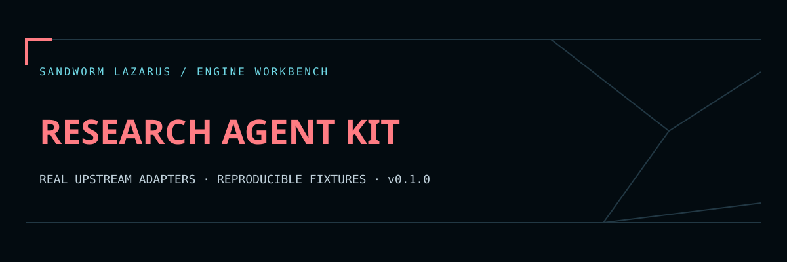

# Sandworm Research Agent Kit



Evidence-bound research in Thai and English, built on **Pydantic AI 2.67.0**. Turn a supplied source bundle into typed, region/version-tagged evidence rows, explicit unknowns, and files consumable by Sandworm Thai Eval Studio and AI Run Ledger.

[คู่มือภาษาไทย](README.th.md) · [Threat model](SECURITY.md) · [Development](docs/DEVELOPMENT.md)

## What Sandworm adds

1. **Plan:** validate source/question identities and the exact source scope for each question.
2. **Extract:** make one structured Pydantic AI request, with no browsing or execution tools.
3. **Review:** require every supported claim to equal a contiguous source excerpt. Derive URL, region and version from the original source record, never from the model. Unsupported answers must be `NR` with no citation.
4. **Export:** SHA-256 provenance, evidence report, Thai Eval candidate/contract files, and one Ledger attempt row with aliased model identity.

This enforces extractive evidence provenance. It **does not prove that a source is true, current, authoritative, or relevant to the question**. Human review remains necessary. The example game rules are invented fixtures, not Trickster Online facts.

## Install

Python 3.11+; developed and tested on Python 3.12. No GPU required when using a remote provider.

```sh
python -m venv .venv
.venv/bin/python -m pip install -r requirements.lock
.venv/bin/python -m pip install --no-deps -e .
```

On Windows use `.venv\Scripts\python.exe`. `requirements.lock` pins the environment used for validation; `pyproject.toml` pins the upstream AI package. No API key is needed for tests or the fixture workflow.

## Run a real framework workflow without an API call

```sh
.venv/bin/sandworm-research examples/study.json \
  --fixture-draft examples/draft.json --output output/fixture
```

The supplied draft is returned through an actual Pydantic AI **FunctionModel**, parsed as the typed output, then reviewed by Sandworm. This is labeled `mode: fixture` throughout. Token counts are synthetic framework estimates, not model benchmark or billing data. It is not an LLM inference demo.

Output directory must be new. Files:

| File | Purpose |
|---|---|
| `report.json` | Evidence, source identity, exact input hash, limits and framework version |
| `thai_eval_candidates.json` | Import into Thai Eval Studio's candidate outputs field |
| `thai_eval_contract_dataset.json` | A generated **contract check**, not an independently authored answer-quality benchmark |
| `ledger.jsonl` | One attempt in AI Run Ledger's input format; synthetic runs have the `synthetic-research-model` alias |

The generated contract dataset verifies citations/abstention shape. Add independently written assertions and expected answers before interpreting a Thai Eval score as quality. Repeated runs use the same local attempt ID: assign unique IDs before combining multiple Ledger files.

## Live mode: explicit, metered and optional

Set `OPENAI_API_KEY` in the process environment using your normal secret manager. Never commit a key or put it in a command argument. Select a current model supported by the OpenAI Responses API explicitly:

```sh
.venv/bin/sandworm-research examples/study.json --live \
  --model YOUR_RESPONSES_MODEL --budget examples/budget.json --output output/live
```

Live mode sends the entire supplied source bundle to the fixed official OpenAI API endpoint. It does not fetch source URLs. The budget file contains **example user-entered rates, not current provider prices**; replace them before live use.

Before generation, Sandworm checks the declared maximum input/output reservation against the user-entered price budget. Pydantic AI performs provider token counting before the live generation request and enforces the configured context cap. One agent response is allowed, output retries are zero, SDK transport retries are disabled, and a wall-clock timeout and output-token setting are supplied. No fallback model is configured.

The provider token-counting pass can itself involve an API request. Pydantic AI's cost guard depends on available pricing/usage metadata and can reject after a response. Manual rates can be stale; timeouts do not prove a provider did not bill a request. **The reservation is a preflight guard, not a guaranteed provider billing ceiling.** Provider account spending limits remain separate. No paid provider request was made during this repository's validation.

## Inputs, privacy and limits

- UTF-8 JSON only; maximum 512 KiB; duplicate keys, nonfinite numbers and unknown fields rejected.
- Up to 64 sources and 32 questions. Source text max 32,768 characters; extracted claim max 1,024 characters.
- Source URLs must be HTTPS identifiers without credentials, query strings or fragments. They are not visited.
- Report/export files include selected excerpts, source IDs, URLs and region/version labels. Review them before sharing. Full source text is not exported.
- Errors contain stable codes, never original model exceptions or raw input. No history store, external telemetry setup or automatic notifications.
- There is no model-written code execution, automatic tool calling, browser control or arbitrary provider endpoint setting.

## Tests

```sh
.venv/bin/python scripts/validate.py
node --test tests/web.test.cjs
```

The Python suite includes real FunctionModel and TestModel runs, invalid/hallucinated source handling, Thai preservation, budget/usage guards, CLI privacy, and native Sandworm export contracts. Validation writes source and fixture SHA-256 hashes into `reports/validation.json`. That file records reproducibility, not upstream authenticity or model quality.

Original code: MIT. Upstream attribution: [THIRD_PARTY_NOTICES.md](THIRD_PARTY_NOTICES.md).

## Sandworm report workspace

The original Sandworm navy/coral theme is included in `web/`. Read [the viewer guide](docs/WEB_VIEWER.md) for local serving, normalized JSON import and export, and [verification scope](docs/BROWSER_QA.md) for the browser QA limit. Run `node --test tests/web.test.cjs` alongside the engine checks above. No worker or scheduler is deployed by opening this static viewer.

The cloud development and upstream smoke checks are reproducible from this repository. A continuously running service needs your own worker/server, authentication, job limits and operational setup. Public source contains synthetic fixtures; local dependencies, secrets, scan targets, model caches and databases are excluded.

Original Sandworm code is MIT-licensed. Upstream engines retain their respective licenses and credit; embedded fonts use OFL with notices in `web/fonts/`.
